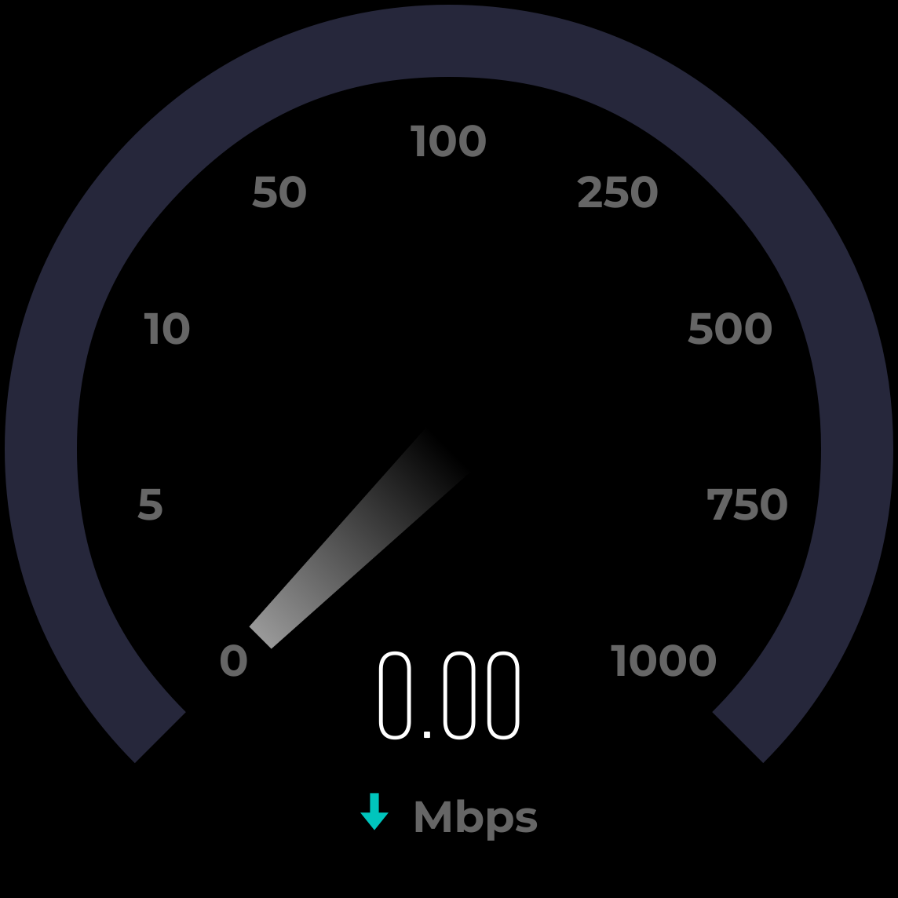
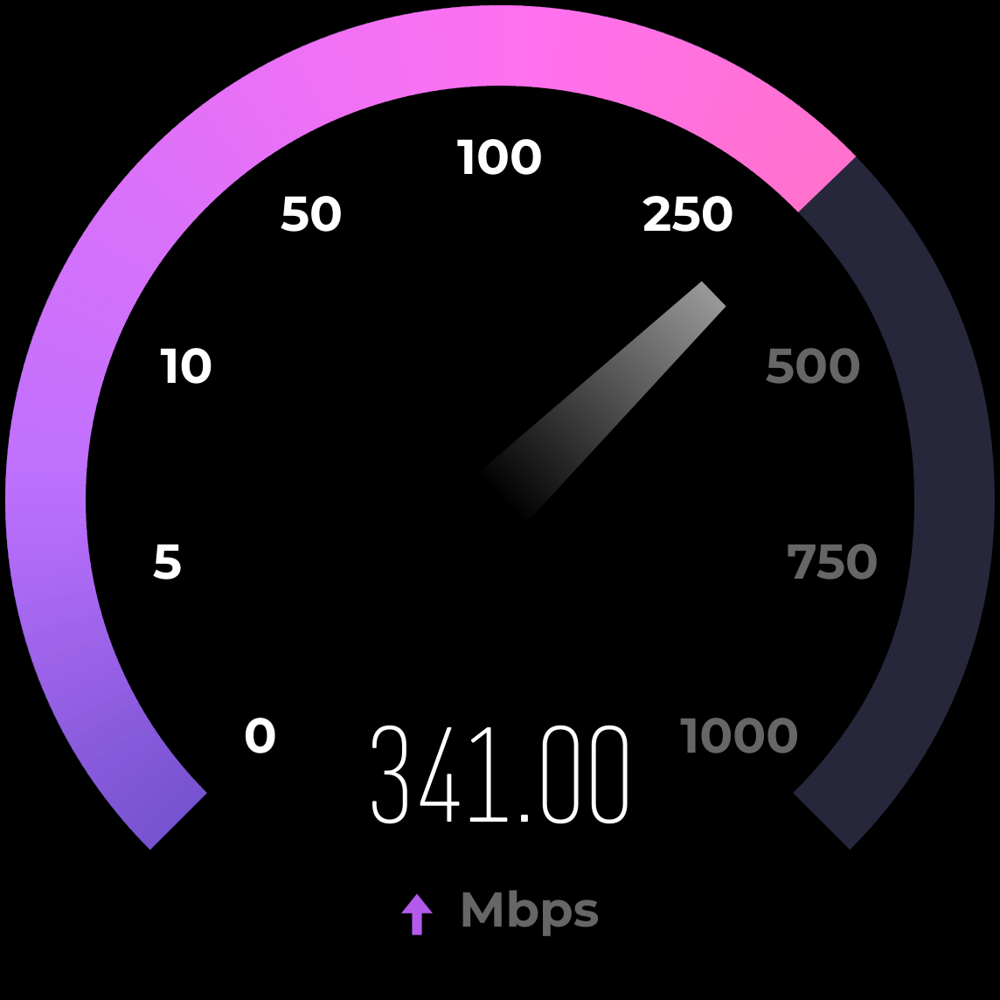
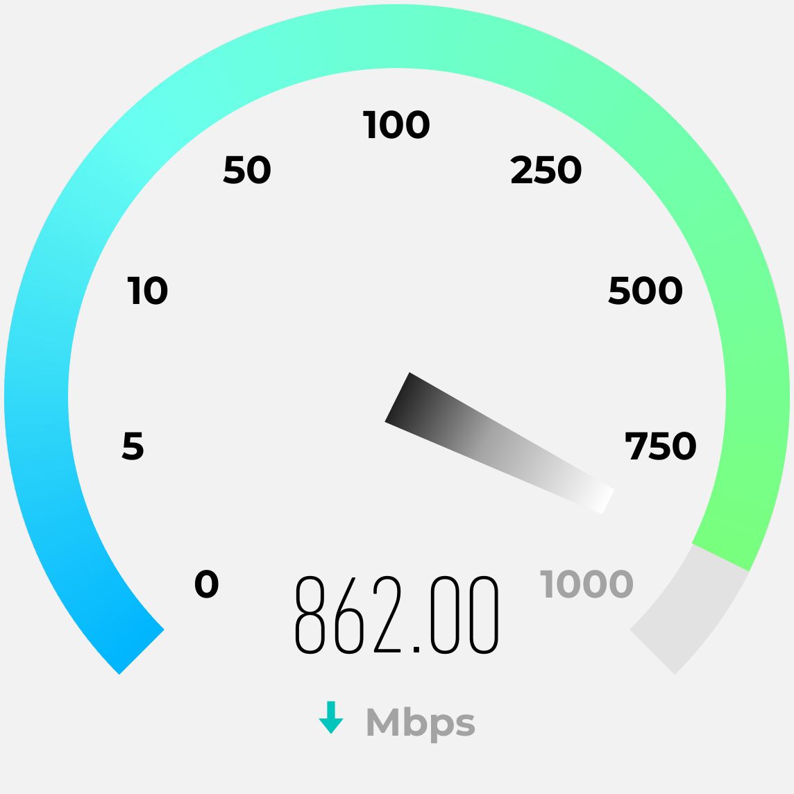
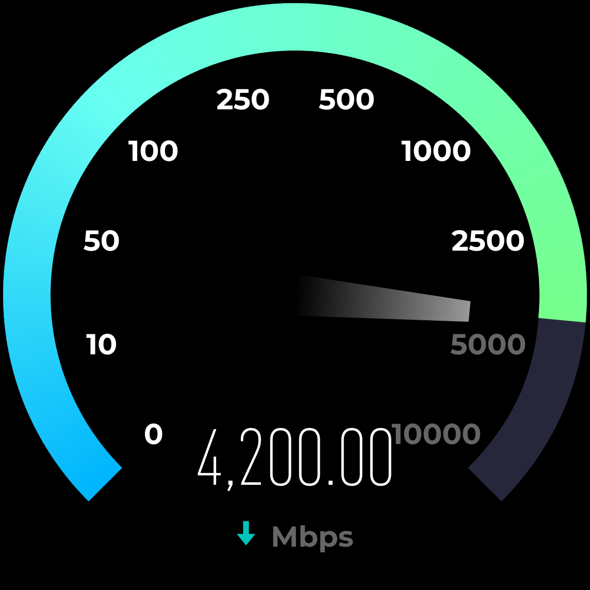
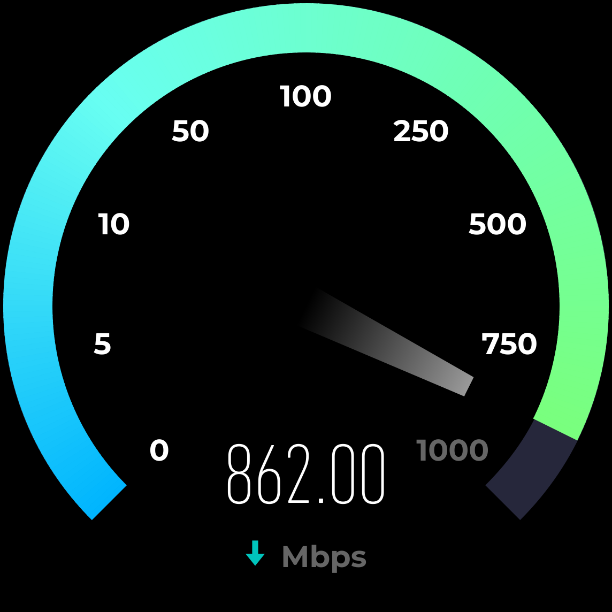
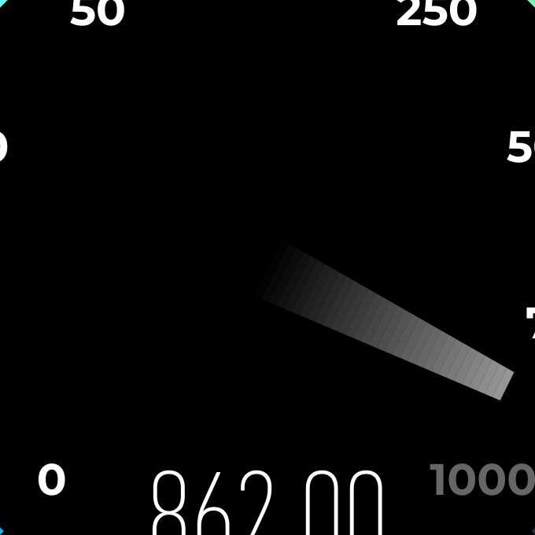
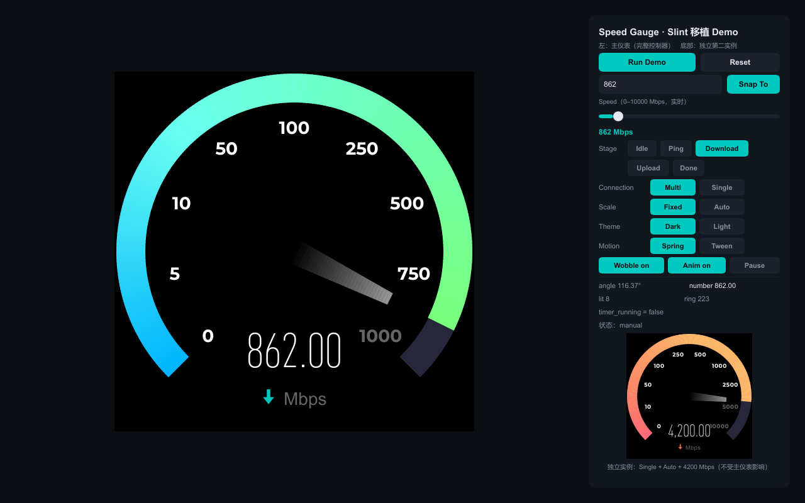
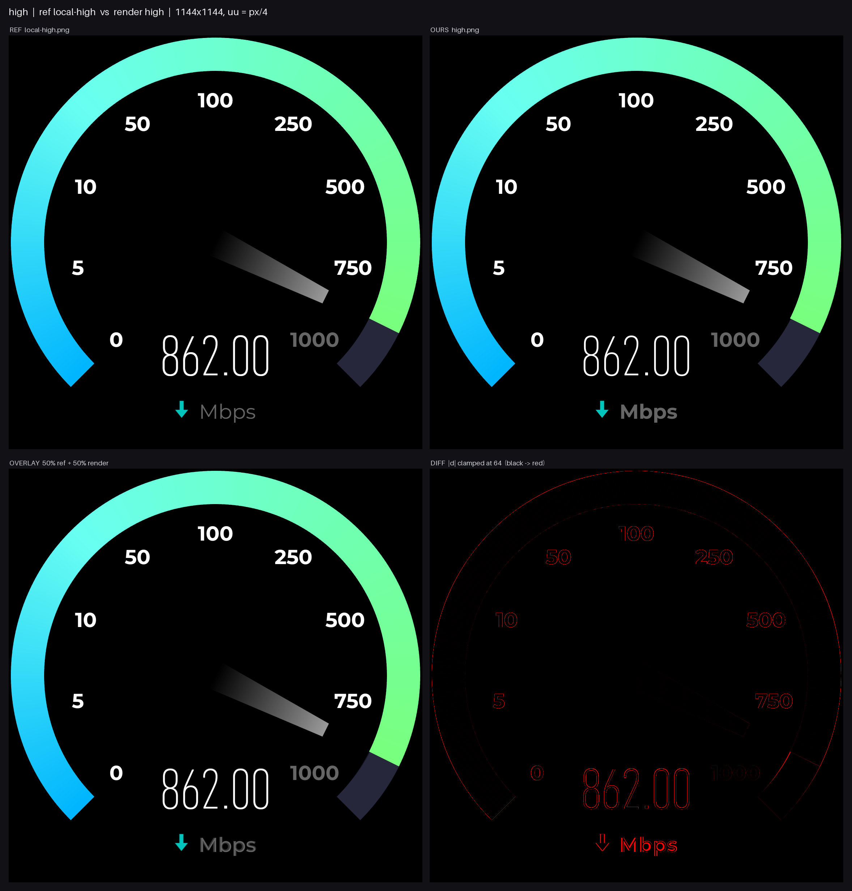

<div align="center">


# speedtest-gauge-rs

**用原生 Rust + Slint 复刻 speedtest.net 那个会抖的测速仪表盘。**

不是圆环进度条，不是 canvas 贴图，也不是 WebView 里塞一个网页。

[](https://www.rust-lang.org/)
[](https://slint.dev)
[](LICENSE)
[](tests)
[](Cargo.toml)
[](#已知不完美的地方)
[](https://github.com/HELPMEEADICE/speedtest-gauge-rs/commits/main)

</div>

---

## 这是什么

上游 [speedtest-gauge-svg](https://github.com/HELPMEEADICE/speedtest-gauge-svg) 是用 TypeScript + SVG 把 speedtest.net 的测速仪表盘逆向复刻出来的（几何、配色、动画参数全部可溯源到生产构建产物）。这个仓库做的事很简单也很烦：**把它整个搬到一个没有 DOM、没有 CSS、没有浏览器排版引擎的世界里，然后要求像素级对齐。**

搬完的结果：一个 `SpeedGauge` Slint 组件 + 一个 `GaugeHandle` 控制器，能塞进任何 Rust + Slint 应用；配套一个能跑完整测速流程的交互 Demo；以及一套把渲染结果和原版截图逐像素对拍的回归体系。

<div align="center">





<sub>空闲 / 下载 862 Mbps / 上传 341 Mbps —— 均为 1144×1144 实际渲染输出（不是设计稿）</sub>

</div>

还有浅色主题（上游没有浅色的仪表截图可对照，所以这一套**不敢称像素级**，只做了几何与解析目标校验）：

<div align="center">



</div>

---

## 三个把我拦住的地方

如果只是想"画个圆弧进度条"，半天就完事了。真正花时间的是这三个坑——它们都有一个共同点：**不报错，静默给你一个错的结果。**

### 坑 1：软件渲染器把 `transform` 写成了空函数

指针要绕圆心转 116.37°。最自然的写法是给 `Path` 加 `transform-rotation`。它能编译、能通过 lint、在 GPU 后端跑起来也完全正确——但在无窗口的软件渲染器里：

```rust
// i-slint-renderer-software-1.18.1/lib.rs:3096
fn rotate(&mut self, _angle_in_degrees: f32) {
    // TODO (#6068)
}
fn scale(&mut self, _x_factor: f32, _y_factor: f32) { /* 同样空 */ }
```

于是"视觉回归截图"和"真机画面"会悄悄分叉。解决办法是**不在视图层旋转**：Rust 侧直接把指针多边形按角度烘焙成 `commands` 字符串。慢一点，但两个后端画出来的东西完全一样——这恰好是"截图能代表真机"的前提。

### 坑 2：渐变填充的路径，一个像素都不画

指针是"顶端 60% 白 → 根部全透明"的纵向渐变。Slint 有 `Brush::LinearGradient`，API 齐全，赋值成功，属性读回来也对。但在软件渲染器里：

```rust
// i-slint-renderer-software-1.18.1/lib.rs:3022
let fill_brush = path.fill();
if !fill_brush.is_transparent() {
    let fill_color = self.alpha_color(fill_brush.color());  // ← 只取 color()
```

`Brush::color()` 对渐变返回**透明**。于是整条指针消失，没有任何警告。这条把我逼着把指针渐变重做了四轮（下面详述）。

### 坑 3：`Path` 的 viewBox 不缩放描边

`viewbox-width: 286` 会把几何按比例缩放，**描边宽度却纹丝不动**——语义上更像 SVG 的 `vector-effect: non-scaling-stroke`。更绕的是 `i-slint-core/items/path.rs` 里拟合时会先把画布减去 `stroke_width` 再整体偏移 `stroke/2`：

```rust
let bounds_width = (geometry.width_length() - stroke_width).max(LogicalLength::zero());
// 再偏移 stroke_width / 2
```

结果：286 单位的图被塞进 263 单位的框里（缩放 0.9196），环半径从 130 变成 119.8。要把画布写成 `309px * k`、原点写成 `-11.5px * k`，缩放与偏移才会互相抵消回到 1:1。

---

## 指针渐变：四次尝试，三个失败

这段值得单独说，因为它最能说明"像素级"到底意味着什么。

上游的实现是：一个绕圆心旋转的 `<path>`，填充 `objectBoundingBox` 纵向渐变。在 Slint 里由于坑 1 + 坑 2，这条路直接封死。于是：

| 方案 | 结果 | 为什么 |
|---|---|---|
| A. 沿轴切 32 片，每片 `rgba(255,255,255,a)` | 接缝 **21/255** | 软件渲染器**逐路径 `over`** 合成：共享边像素上第二片的覆盖率不是"权重"，而是把前一片已画的部分按比例又抹掉一次 → 偏差 `−a²c(1−c)·255` |
| B. 同上，但预合成成不透明色 | 接缝 **36/255**（更差） | 同一个机制换了个量纲：`c(1−c)(P−C_i)`，比值恰好 `1/a ≈ 1.7`。我的模型被实测否证 |
| C. B + 相邻片重叠并按 `b'=(target−a)/(1−a)` 补偿 | 接缝 **60/255**（最差） | 递推收敛到 `target/2`，误差从接缝搬到了整条指针上 |
| D. **整条指针用 tiny-skia 光栅化成一张 RGBA 图** | 接缝 **1.00/255** | 一张图一次绘制 = 每像素只合成一次 = 接缝在原理上不存在 |

<div align="center">




<sub>左：32 片切片的接缝（放大 4 倍，能看到条纹）；右：光栅化之后。同一台机器、同一份代码、同一个角度。</sub>

</div>

代价是每帧多一次纹理上传（0.07 ms @DPR1 / 0.34 ms @DPR2，占整帧 &lt;1%），画布缓冲在稳态**零重建**（`resizes()` 计数不变，有测试锁着）。不想付这个代价可以关掉 `needle-raster` feature，退回方案 A 并接受那 21/255 的接缝。

---

## 快速开始

```powershell
git clone https://github.com/HELPMEEADICE/speedtest-gauge-rs
cd speedtest-gauge-rs

cargo run --release --example demo      # 交互 Demo：滑块、阶段切换、快照、双实例
cargo test --all-targets                # 111 个测试，含像素级视觉回归
cargo run --release --example shots     # 8 个状态出 1144×1144 PNG + 单帧耗时
```

<div align="center">

<sub>Demo：左边主仪表，右边控制面板，右下角第二个仪表是<b>独立实例</b>（Single + Auto + 4200 Mbps），用来当场证明多实例互不影响</sub>
</div>

> ⚠️ 一定带 `--release`。软件渲染路径在 debug 下每帧 160+ ms，release 是 12.6 ms（13 倍）。

---

## 当组件用

```toml
[dependencies]
speed-gauge-slint = { git = "https://github.com/HELPMEEADICE/speedtest-gauge-rs" }
slint = "1.18"
```

```rust
use slint::ComponentHandle;                       // ← 少了这行 .window() 会报错
use speed_gauge_slint::{GaugeHandle, GaugeStage, SpeedGauge};

fn main() -> Result<(), slint::PlatformError> {
    let ui = SpeedGauge::new()?;
    let gauge = GaugeHandle::attach(&ui);

    gauge.set_stage(GaugeStage::Download);
    gauge.set_speed_kbps(862_000.0);              // 内部单位是 kbps，显示自动换算 Mbps

    ui.window().set_size(slint::LogicalSize::new(572.0, 572.0));
    ui.run()
}
```

想在**自己的 `.slint` 布局里**放仪表，就 `import { SpeedGauge } from ".../speed-gauge.slint";` 直接声明——不用 Rust 包一层，也不用任何 experimental API（那只有本仓库的 Demo 才用到）。API 全表见 [README.full.md §4](README.full.md#4-api-表)。

数据接入三种后端随便挑：`ManualSource`（宿主推什么就是什么）、`ChannelSource`（`std::mpsc`，跨线程，无 async 运行时）、`DemoSource`（确定性假数据，用了逐位复刻的 mulberry32）。真正的测速后端怎么接，见 [docs/real-backend.md](docs/real-backend.md)。

---

## 技术栈

| 层 | 用了什么 | 为什么 |
|---|---|---|
| 语言 | **Rust 1.98**（`x86_64-pc-windows-gnu`） | 数值、状态机、动画积分 |
| UI 框架 | **Slint 1.18.1** | 声明式 + 原生矢量 + 无运行时 JS 引擎 |
| 矢量绘制 | Slint `Path` / `Text` / 布局 | 240 段彩弧、轨道、刻度、数字全部声明式 |
| 光栅化 | **tiny-skia 0.11.4**（可选） | 只在指针渐变与无窗口 PNG 编码两处 |
| 图形后端 | femtovg/OpenGL（窗口） + 软件渲染（无窗口回归） | 两套后端画同一份几何 |
| 字体 | Montserrat Bold（SIL OFL，随包） + Gauge Mono（Ookla 专有，**不随包**） | 刻度 / 中文档 / 中央数字 |
| 测试 | `cargo test` + Pillow 像素对拍 + 确定性渲染哈希 | 111 个测试 + 7 状态 A/B 报告 |
| **直接依赖** | **只有 2 个**：`slint` + `tiny-skia` | 没有 tokio，没有 Chromium，没有 WebView |

---

## 和原版差多少

把同一套尺寸、同一套锚点下的渲染结果和上游截图逐像素比较（7 个状态，1144×1144）：

| 指标 | 结果 |
|---|---|
| 全图平均色差 `mean\|Δ\|` | **0.444 – 0.668**（0–255 量纲） |
| 完全一致的像素 | **96.5% – 98.2%** |
| 墨迹掩膜 IoU | **0.928 – 0.982** |
| 亮弧终点角（指针/弧/刻度是否同帧同步） | **Δ ≤ 0.05°** |
| 圆环内外半径 | **≤ 0.295 uu**（≈1.2 px @1144） |
| 中央数字墨迹框 | **≤ 1.00 px** |
| 指针渐变剖面 | **max 1.00 / 255** |
| 颜色 token（轨道/白/灰/渐变 5 点） | **Δ = 0** |
| GPU 后端帧时 | p50 **2.4 ms** / p95 4.4 ms / p99 8.3 ms |
| 空闲 CPU（动画收敛后） | **0.55%**（定时器已停，不是靠空转） |

<div align="center">

<sub>上到下：上游截图 · 我们的渲染 · 50% 叠加 · 差异热力图（越红差越大）。7 个状态的四联图都在 <code>comparison/report/</code></sub>
</div>

剩下那 1%–3% 的差异不是几何错位（bbox 已经压到 1px 内），而是字形抗锯齿的过渡带——Chromium 用 FreeType、Slint 用 skrifa，两边边缘像素不可能逐位相同。这类差一共有 13 条，逐条记在 [docs/known-deviations.md](docs/known-deviations.md)，每条都有机制、量化影响和"试过什么"。

---

## 仓库结构

```
src/            14 个模块：刻度映射 / 几何 / 渐变 / 动画 / 渲染桥 / 控制器 / 数据源 / 光栅化
ui/             speed-gauge.slint（可复用组件） · demo.slint（Demo 窗口）
examples/       demo · minimal · shots · invariance · real_backend
tests/          111 个测试（含 tests/visual.rs：把像素容差写进 cargo test）
docs/           移植规格 · 像素基准 · 模块映射 · 性能实测 · 13 条已知偏差 · 字体度量
tools/          量测与对拍脚本（Pillow/numpy），全部可复跑
comparison/     渲染输出 · 参考度量 JSON · 四联对比图 · 指针迭代证据
README.full.md  ← 完整版工程文档（API 全表、feature flags、许可细节）
```

---

## 已知不完美的地方

写下来是因为它们真实存在，而且**大部分有上界、有实测数字**：

1. **1%–3% 的像素不可能完全相同**——字体光栅器不同（FreeType vs skrifa），这是天花板，不是 bug。
2. **单连接模式的两个强调色没做过像素校准**（上游没提供单连接截图），只有双连接的两个颜色是实测校准过的（`Δ = 0`）。
3. **浅色主题没有官方参考图**，只做了几何与解析目标校验。
4. **文字落点会被量化到整像素**：逻辑尺寸不是 286 整数倍时（比如 300 px），单位行 ink 中心会漂 **0.94 uu ≈ 3.8 px @1144**。矢量量（环、指针、sweep）不受影响，≤0.169 uu。
5. **Demo 用了 Slint 的 experimental API**（`ComponentContainer`），但那只是 Demo 层；组件库本身不依赖它。
6. **Gauge Mono 是 Ookla 的专有字体，不随本仓库分发**。缺它时中央数字回退系统等宽，墨迹宽度差 +42.6%。

---

## 许可

本仓库原创代码以 **WTFPL v2** 发布——原文就在 [LICENSE](LICENSE)：

```
0. You just DO WHAT THE FUCK YOU WANT TO.
```

第三方资产另有归属，详见 [NOTICE.md](NOTICE.md)：Montserrat 依 SIL OFL 1.1 随包分发；Gauge Mono 属 Ookla，**不在**本仓库内；Slint 是 GPLv3 / 商业双许可，使用者自行遵守。上游的 `report/` 参考截图也没有进入本仓库——只有由它派生的**度量数字**。

---

<div align="center">

**延伸阅读** · [完整版文档](README.full.md) · [移植规格](docs/port-spec.md) · [像素基准](docs/visual-targets.md) · [模块映射](docs/module-map.md) · [性能实测](docs/performance.md) · [已知偏差](docs/known-deviations.md)

</div>
